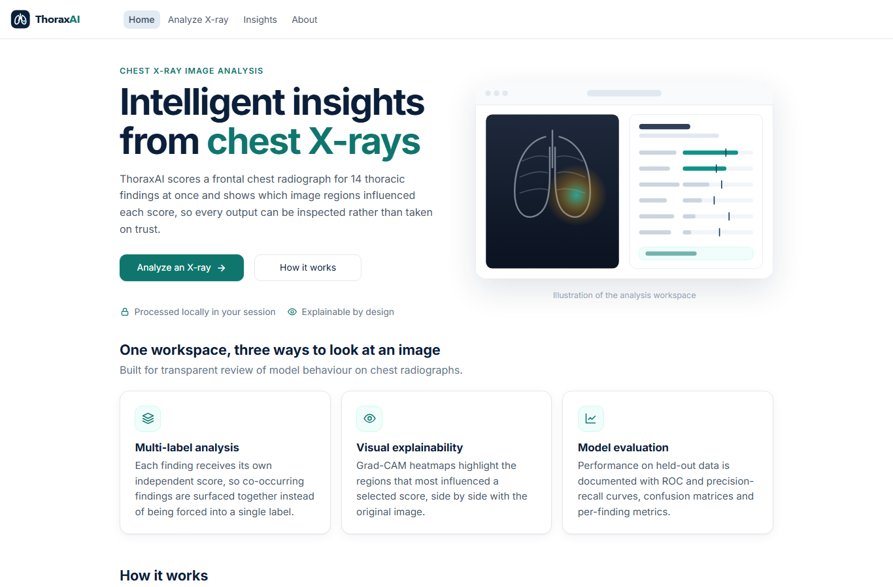
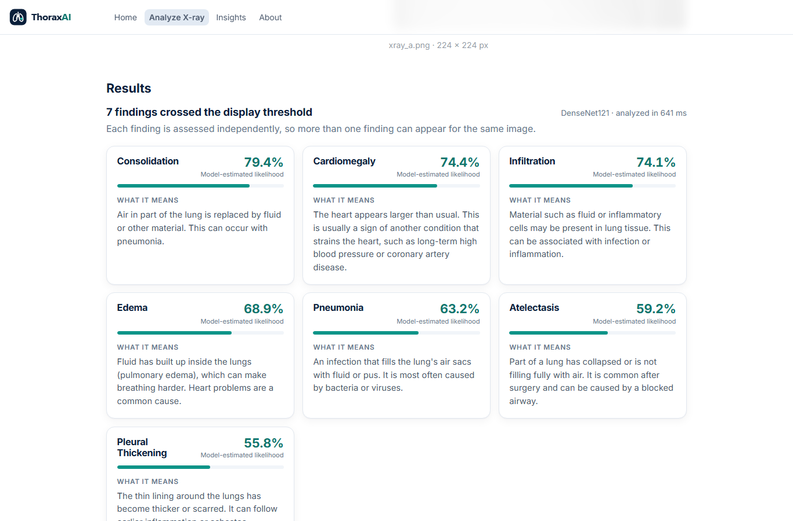
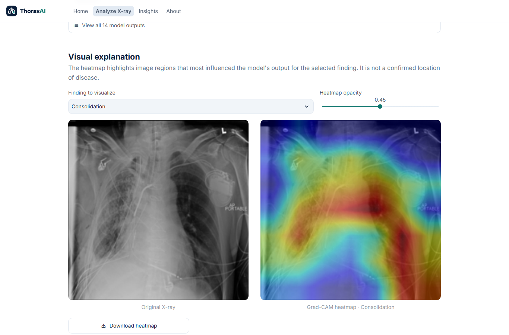
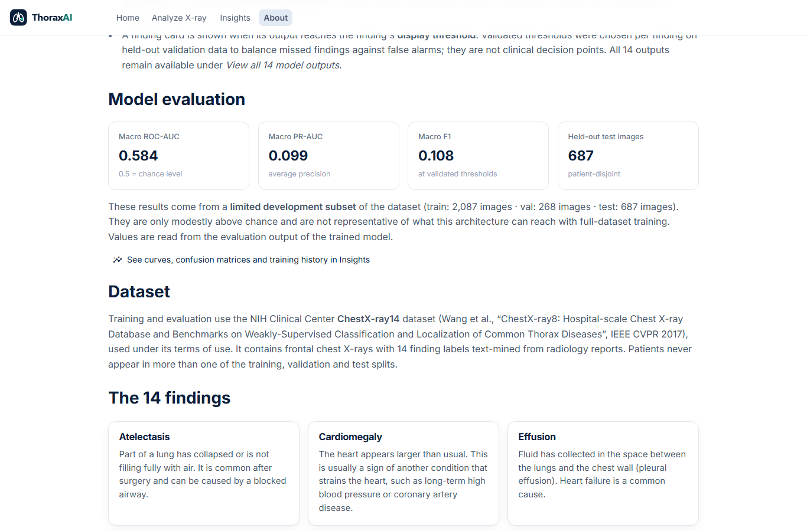
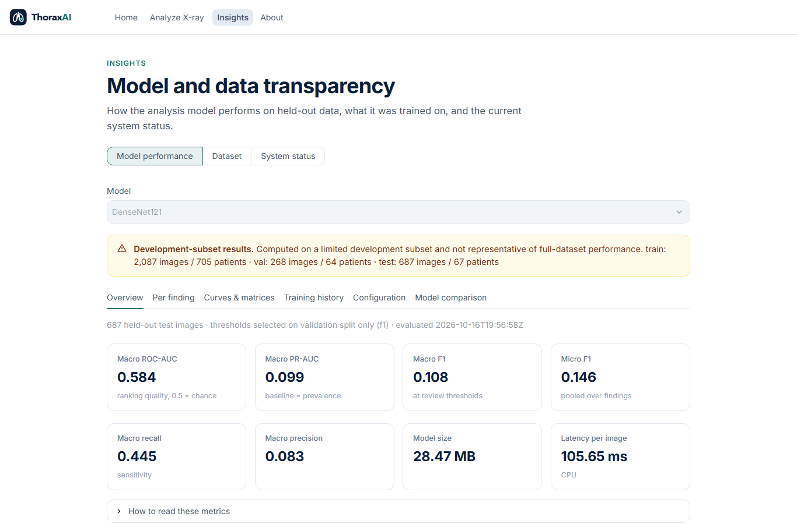
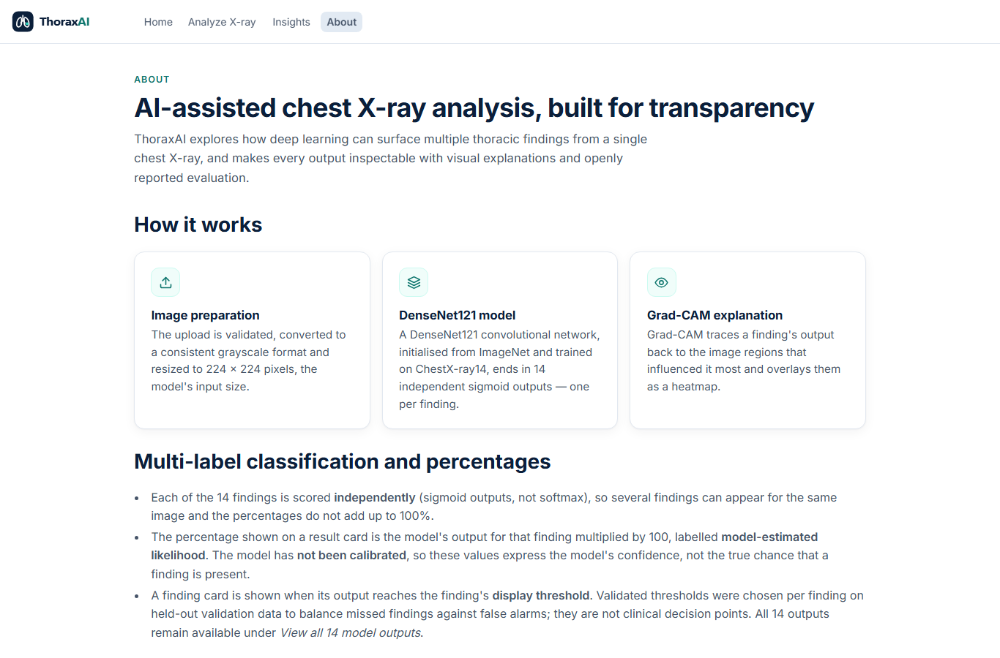

# ThoraxAI

**Multi-label chest X-ray analysis with deep learning, plain-language explanations and Grad-CAM.**
Python · TensorFlow / Keras · Streamlit · NIH ChestX-ray14

> **Research and educational prototype — not a medical device.** ThoraxAI shows model-estimated likelihoods that
> have not been calibrated or clinically validated. They are not diagnoses and must not be used to diagnose, treat or
> triage anyone. The included model was trained on a limited subset of the data and its measured accuracy is modest.

ThoraxAI analyzes a frontal chest X-ray for **14 thoracic findings** at once:

Atelectasis · Cardiomegaly · Effusion · Infiltration · Mass · Nodule · Pneumonia · Pneumothorax · Consolidation ·
Edema · Emphysema · Fibrosis · Pleural Thickening · Hernia

Results appear as clean cards, each showing a percentage and a one- or two-sentence explanation. The app also shows a
Grad-CAM heatmap of the image regions that influenced the model, and publishes its held-out evaluation openly.

---

## Contents

- [Features](#features)
- [Screenshots](#screenshots)
- [How it works](#how-it-works)
- [Project structure](#project-structure)
- [Setup](#setup)
- [Usage](#usage)
- [Testing](#testing)
- [Model results and limitations](#model-results-and-limitations)
- [Safety, privacy and ethics](#safety-privacy-and-ethics)
- [References](#references)

## Features

- **Simple upload.** Drag and drop or browse for a PNG or JPEG (up to 20 MB), with a preview, file validation,
  replace and remove options, and a single **Analyze X-ray** button. Results are cleared whenever the image changes,
  so they always belong to the image on screen.
- **Percentage finding cards.** Each finding that crosses its display threshold gets a card with:
  - the finding name
  - its **model-estimated likelihood** as a percentage, with a slim progress bar
  - a short **What it means** explanation in plain English

  Cards are sorted by the model's output. Because classification is multi-label, several findings can appear for the
  same image. When none crosses its threshold, the page says so neutrally and never calls the X-ray normal.
- **All 14 outputs** are available in one compact list, as percentages.
- **Visual explanation.** The original X-ray is shown beside its real Grad-CAM heatmap for any selected finding.
  The heatmap can be downloaded as a PNG.
- **Display settings.** Choose validated per-finding thresholds (the default), one threshold for all findings, or
  custom per-finding thresholds, all in percent.
- **About and Insights pages** hold the technical detail: model architecture, dataset, how the percentages are
  calculated, evaluation metrics read from the real evaluation files, limitations, privacy and medical sources.
  Insights adds ROC and precision-recall curves, confusion matrices, training history, dataset statistics and
  system status.
- **Friendly error states.** Invalid or corrupted images, a missing model, inference failures and heatmap failures all
  show plain-language messages. Technical details go to the server log, not to the screen.

### How the percentages are calculated

The model's final layer is `Dense(14, activation="sigmoid")`, so it already outputs an independent value between
0 and 1 for each finding. ThoraxAI multiplies that value by 100. It does not apply sigmoid a second time and never
uses softmax.

`Predictor` checks the final layer's activation when it loads a model. A model with raw logit outputs would get
sigmoid applied exactly once, and anything else is rejected. NaN or out-of-range values are refused rather than
displayed.

No probability calibration has been performed, so the UI labels the values **"Model-estimated likelihood"** and not
"probability of disease". See `src/predict.py`.

## Screenshots

These are real screenshots of the running application. The analysis uses a held-out image from the public
NIH ChestX-ray14 test split, and the percentages shown are genuine model outputs.

| Home | Analysis: finding cards |
|---|---|
|  |  |
| **Analysis: Grad-CAM visual explanation** | **About: model evaluation** |
|  |  |
| **Insights: model performance** | **About: overview** |
|  |  |

## How it works

```
Upload (PNG/JPEG) ─► validate & convert to RGB ─► resize 224×224 ─► DenseNet121 (normalisation inside model)
      ─► 14 sigmoid outputs ─► × 100 = model-estimated likelihood (%) ─► compare with validated display thresholds
      ─► finding cards (name · % · what it means) ─► Grad-CAM heatmap for a selected finding
```

| Step | Details |
|---|---|
| Data | NIH ChestX-ray14. Official patient-disjoint test list preserved; validation uses 10% of train/val **patients**; no patient appears in two splits |
| Model | ImageNet DenseNet121 → global average pooling → dropout → Dense(14, sigmoid) |
| Training | Class-balanced weighted binary cross-entropy, AdamW, early stopping on validation macro AUC; optional fine-tuning |
| Thresholds | Per finding, chosen to maximise F1 on the **validation** split only; the test split is used once for evaluation |
| Explanation | Grad-CAM on the last convolutional block (Selvaraju et al., 2017) |

More detail: [`docs/methodology.md`](docs/methodology.md) · [`docs/architecture.md`](docs/architecture.md)

## Project structure

```
app.py                     Streamlit entrypoint (top navigation: Home · Analyze X-ray · Insights · About)
config.py                  labels, architectures, paths (local_config.json / THORAXAI_* env overrides)
app_pages/                 home.py, analyze.py, insights.py, about.py
src/
  dataset.py               dataset discovery, metadata parsing, patient-level splits, validation report
  preprocessing.py         safe image loading/validation, tf.data pipelines, augmentation
  model.py                 DenseNet121 / MobileNetV2 multi-label model, weighted loss, safe model loading
  train.py, evaluate.py    training (+ validation thresholds) and held-out evaluation
  predict.py               framework-independent inference (Predictor)
  gradcam.py               Grad-CAM and overlay
  summary.py               results headline built from real outputs
  findings_info.py         short, sourced explanations for the 14 findings (single source of truth)
  metrics.py, plots.py     multi-label metrics and figures
  ui.py                    design system (theme CSS, components, status checks)
  views/                   Insights views and the percentage finding cards
scripts/                   validate_dataset.py, train_model.py, evaluate_model.py
tests/                     pytest suite (synthetic data and mocked models only)
docs/                      methodology, architecture, testing, limitations, medical references, report draft
assets/                    logo and icon
```

Not in the repository (git-ignored): the dataset, trained model files (`models/`), generated results
(`results/`), the virtual environment and `local_config.json`.

## Setup

### 1. Requirements

- **Python 3.12.** TensorFlow 2.18 supports Python 3.9–3.12, not 3.13.
- About 3 GB of disk space for the environment, plus space for the dataset. The full Kaggle download is about 45 GB;
  224 px copies are about 3 GB.
- A CPU is enough. Native-Windows TensorFlow is CPU-only; for an NVIDIA GPU use Linux or WSL2.

### 2. Install

Windows (PowerShell), from the project folder:

```powershell
py -3.12 -m venv .venv
.venv\Scripts\python -m pip install --upgrade pip
.venv\Scripts\python -m pip install -r requirements.txt
```

Linux / macOS: use `python3.12 -m venv .venv`, then `.venv/bin/python -m pip install -r requirements.txt`.

### 3. Get the dataset

Download **NIH ChestX-ray14** from Kaggle: <https://www.kaggle.com/datasets/nih-chest-xrays/data>. A free account
is required, and you must accept the dataset terms. Extract it anywhere; it does not need to be inside the project.

The loader finds `Data_Entry_2017*.csv`, the official `train_val_list*.txt` / `test_list*.txt` split lists, and
images in any sub-folder layout. Pre-resized 224 px copies (e.g. an `images-224/` folder) also work.

### 4. Point ThoraxAI at the dataset

```powershell
copy local_config.example.json local_config.json
```

Edit `local_config.json`, using forward slashes:

```json
{ "data_dir": "C:/path/to/NIH-ChestXray14" }
```

Optional keys are `metadata_csv`, `image_root`, `models_dir` and `results_dir`. The environment variables
`THORAXAI_DATA_DIR` etc. override the file for one terminal session. No other environment variables, secrets or
API keys are needed.

### 5. Validate, train, evaluate

```powershell
.venv\Scripts\python scripts\validate_dataset.py --verify all
.venv\Scripts\python scripts\train_model.py --model densenet121 --mode development --dry-run
.venv\Scripts\python scripts\train_model.py --model densenet121 --mode development
.venv\Scripts\python scripts\evaluate_model.py --model densenet121
```

- `--dry-run` checks data, splits, the input pipeline and the model without training.
- Development mode trains on a reproducible 3,000-image patient-level subset, which takes roughly 15–40 minutes
  on a laptop CPU. Use `--dev-max-images 15000` or `--mode full` for better models; a GPU is strongly recommended
  for full mode.
- Training writes `models/densenet121/best_model.keras` plus its configuration and thresholds. Evaluation writes
  `results/densenet121/`.

**Trained model files are not in this repository.** Re-create them with the commands above. If you already have a
trained model, place these files in `models/densenet121/`:

- `best_model.keras`
- `threshold_config.json`
- `model_config.json`
- `label_mapping.json`

## Usage

```powershell
.venv\Scripts\python -m streamlit run app.py
```

Open <http://localhost:8501>.

1. **Analyze X-ray:** drag and drop (or browse for) a frontal PNG/JPEG chest X-ray, up to 20 MB, then press
   **Analyze X-ray**.
2. Read the finding cards: each shows the model-estimated likelihood and what the finding means. *View all 14 model
   outputs* lists every percentage.
3. Choose a finding under **Visual explanation** to see its Grad-CAM heatmap beside the original X-ray.
4. Use **Remove image** or drop a new file to analyze another X-ray.
5. Use **About** for how the model works, its evaluation and its limitations, and **Insights** for detailed charts.

If port 8501 is busy, add `--server.port 8502`.

## Testing

```powershell
.venv\Scripts\python -m pytest -q tests
```

The suite has 108 tests and takes about 2 minutes on CPU. It covers:

- data handling, preprocessing and label encoding
- the model, metrics and thresholds
- prediction, Grad-CAM and their error handling
- percentage conversion, including that sigmoid is never applied twice, logit models, rejected invalid outputs,
  and that each percentage maps to the right label
- the finding explanations, the card content and the medical-content wording checks
- every app page with and without a model or dataset

The tests use synthetic images and mocked or randomly initialised models only. See
[`docs/testing.md`](docs/testing.md) for the latest report.

## Model results and limitations

The included DenseNet121 was trained in **development mode**: 2,087 training images, 268 validation images and
687 held-out test images from 67 patients. On that test subset it reached:

| Metric (held-out test subset) | Value |
|---|---|
| Macro ROC-AUC | 0.584 |
| Macro PR-AUC | 0.099 |
| Macro F1 (validation thresholds) | 0.108 |

That is only modestly better than chance (ROC-AUC 0.5), and much weaker than published full-dataset models.
These numbers come from `results/densenet121/test_metrics.json` and are not representative of full-dataset
training. Other limitations:

- **Labels:** text-mined from radiology reports and noisy. All images come from a single hospital system.
- **Resolution:** images are scored at 224×224, which loses fine detail.
- **Scores:** uncalibrated, and the thresholds maximise validation F1; they are not clinical operating points.
- **Grad-CAM:** coarse, and it can highlight shortcuts such as tubes, wires or text markers.
- **Validation:** not clinically validated or approved by any regulator.

See [`docs/limitations.md`](docs/limitations.md).

## Safety, privacy and ethics

- **Not for clinical use.** The analysis page ends with one subtle notice. The About page explains intended use and
  limitations in full.
- **Local processing.** Uploaded images are processed in memory on the machine running ThoraxAI. They are not sent
  to third parties and are not stored unless the user downloads a heatmap.
- **Medical content.** It is short, general and sourced. There is no advice and no treatment recommendations, and
  it is checked by tests for advice, alarming or certainty wording. Sources are listed in
  [`docs/medical_references.md`](docs/medical_references.md).
- **Model loading.** Only `.keras` files from `models/` are loaded, with Keras safe mode. User-uploaded model files
  are never accepted.

## References

- X. Wang et al., "ChestX-ray8: Hospital-scale Chest X-ray Database and Benchmarks on Weakly-Supervised
  Classification and Localization of Common Thorax Diseases," *IEEE CVPR*, 2017. Dataset provided by the NIH
  Clinical Center.
- G. Huang et al., "Densely Connected Convolutional Networks," *IEEE CVPR*, 2017.
- P. Rajpurkar et al., "CheXNet: Radiologist-Level Pneumonia Detection on Chest X-Rays with Deep Learning,"
  arXiv:1711.05225, 2017.
- R. R. Selvaraju et al., "Grad-CAM: Visual Explanations from Deep Networks via Gradient-based Localization,"
  *IEEE ICCV*, 2017.
- Medical information sources for the finding explanations: [`docs/medical_references.md`](docs/medical_references.md).

Dataset images are from NIH ChestX-ray14 and are used under its terms. Screenshots include one such image for
illustration.
